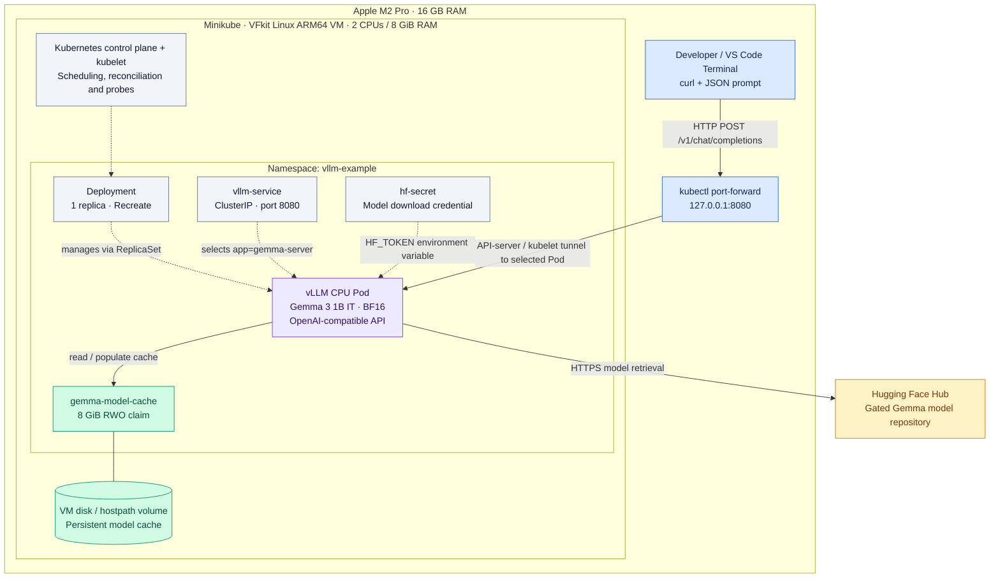
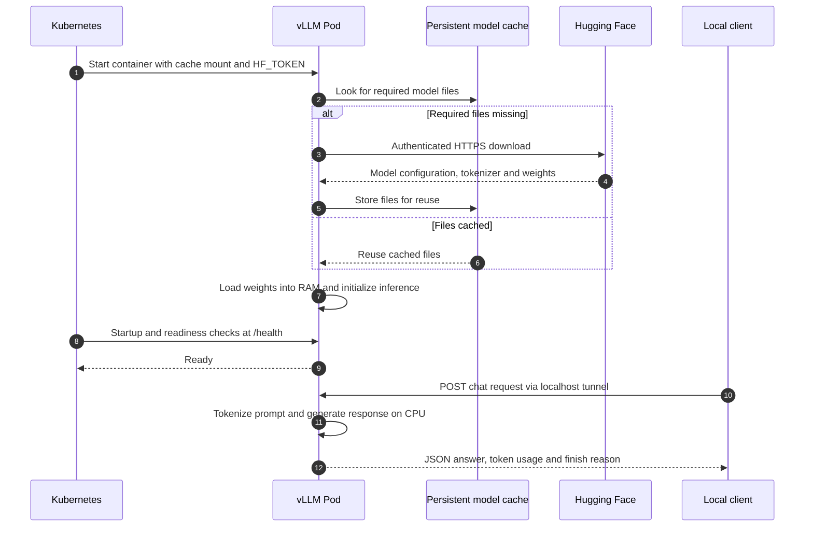

# System Design · AI Inference on Kubernetes

> **Local compute. Persistent model cache. An OpenAI-compatible inference API.**
>
> A working adaptation of the Kubernetes vLLM example for an Apple M2 Pro with 16 GB RAM. The design preserves vLLM and Google Gemma while fitting a single Linux ARM64 CPU node without cloud infrastructure.

## 1. Design goals and boundaries

| Goal | Design response |
| :--- | :--- |
| Serve a real language model locally | Gemma 3 1B IT runs inside a vLLM Kubernetes Pod |
| Fit the laptop's resource budget | 8 GiB VM, 6 GiB container limit, bounded context and KV cache |
| Reuse downloaded weights | Hugging Face cache mounted on a persistent volume |
| Provide a reproducible deployment | Declarative manifests and a container image pinned by digest |
| Demonstrate operational reasoning | Probes, explicit resource limits, documented failures and real API verification |
| Avoid a cloud subscription or paid inference API | CPU inference on the existing laptop; internet needed to acquire images and model files |

This is a single-node learning and demonstration system. High availability, public access, production security, and throughput guarantees are outside the implemented scope.

## 2. High-level architecture

**Networking detail:** the command targets `service/vllm-service`, but `kubectl port-forward` selects a backing Pod and tunnels to it; it does not send packets through the Service's ClusterIP. In-cluster clients can use the Service directly. This demo validates the Service selector and the Pod endpoint, not the ClusterIP network path.

**Storage boundary:** the PVC survives Pod replacement. Its backing storage is inside the Minikube VM, not a separate durable storage service. Deleting the cluster removes this cache. The 8 GiB claim is not a guaranteed hostpath disk quota; images and cached files share the VM disk.

## 3. Startup and inference lifecycle

The cache stores files on disk; inference loads weights into RAM. The KV cache stores attention state for active generation and has a separate 256 MiB budget. Cached weights reduce repeat downloads, but do not remove model initialization time or guarantee fully offline startup with the current configuration.

## 4. Key engineering decisions

| Decision | Why it fits this system | Cost or limitation |
| :--- | :--- | :--- |
| Linux ARM64 CPU serving | Matches the available hardware and retains vLLM | Apple GPU acceleration is not used; CPU latency is unbenchmarked |
| vLLM 0.30.0, digest pinned | This configuration completed real inference after compatibility trials | Version upgrades require actual generation tests, not just successful imports |
| One replica with Recreate updates | Avoids overlapping model instances within the memory budget | Updates interrupt service; no redundancy |
| 256-token context, one sequence | Bounds inference memory for a small local demo | Prompt and answer share a short context; unsuitable for long incident logs |
| 128-token prefill batches, 256 MiB KV cache | Reduces working memory pressure | Throughput and concurrency are deliberately constrained |
| CPU uni executor and eager execution | Working configuration within the observed resource limits | Performance optimizations require separate evaluation |
| PVC-backed Hugging Face cache | Reuses approximately 1.9 GiB of model files across Pod changes | Single-node storage, no backup or failure-domain isolation |
| ClusterIP plus loopback forwarding | Convenient local access without a public endpoint | Forwarding must remain active and may need restarting after Pod replacement |
| Secret reference and no mounted service-account token | Keeps credentials out of manifests and avoids unnecessary Pod API credentials | Kubernetes Secrets alone do not establish encryption at rest; local API has no configured API-key authentication |

The container requests **1 CPU / 4 GiB** and is limited to **2 CPUs / 6 GiB**. The VM has **2 CPUs / 8 GiB**, also supporting Kubernetes and other system processes. These budgets describe configuration, not measured peak utilization.

## 5. Failure handling and operational checks

| Failure | Expected behavior / diagnostic approach |
| :--- | :--- |
| Invalid token or missing Gemma access | Download fails; run the sanitized authentication and model-access checks |
| Cold download or slow initialization | Startup probe permits roughly 30 minutes before restart; inspect logs and network access |
| Process becomes unhealthy | Liveness probe can trigger a restart; readiness excludes an unready Pod from Service endpoints |
| Memory limit exceeded | Container may be OOMKilled; inspect termination reason and tune runtime buffers |
| Disk fills with images and cached files | Pulls or downloads may fail; check the shared VM filesystem |
| Pod replaced | Deployment creates a replacement; weights can be reused from the PVC, then must load into RAM |
| Node or laptop unavailable | Entire service is unavailable; there is no failover node |
| Generation stops early | Inspect finish_reason and token budget; a successful HTTP response alone does not prove a complete answer |

A health probe proves less than an inference test. In this project, vLLM 0.32.0 reached readiness after tuning but failed during generation. The final 0.30.0 configuration passed a complete chat request. See [troubleshooting](docs/troubleshooting.md) for the recorded experiments.

## 6. Evidence and limits

The [verification record](docs/verification.md) captures successful model authentication, a Bound PVC, a Ready serving Pod, `/health`, `/v1/models`, and a generated answer with **16 prompt tokens, 41 completion tokens, and finish_reason=stop**. The [saved response](examples/chat-response.json) is evidence of a real request, not a performance benchmark.

The incident-triage demo supplies a **simulated incident as prompt text**. The model does not inspect Kubernetes resources or collect application logs. Its answer is a diagnostic suggestion for a human to assess.

## 7. Future evolution — not implemented

1. **Reproducibility:** pin the model revision and verify startup from an existing cache.
2. **Reliability:** exercise Pod replacement, VM stop/start, and recovery after failures; record outcomes.
3. **Performance:** measure time to first token, total latency, throughput and memory under controlled load before setting SLOs.
4. **Observability:** collect inference and Kubernetes metrics, then define useful alerts and dashboards.
5. **Production access:** design authentication, TLS, network isolation, secret management and abuse controls before public exposure.
6. **Scale:** choose suitable accelerator hardware and independent failure domains, then reassess replicas, storage, routing and rollout strategy. This is a separate architecture and cost decision.

## Related documents

- [Architecture and exact technology stack](Architecture.md)
- [Requirements](prd.md)
- [Deployment procedure](docs/deployment.md)
- [Upstream Kubernetes vLLM example](https://github.com/kubernetes/examples/tree/master/AI/vllm-deployment)
